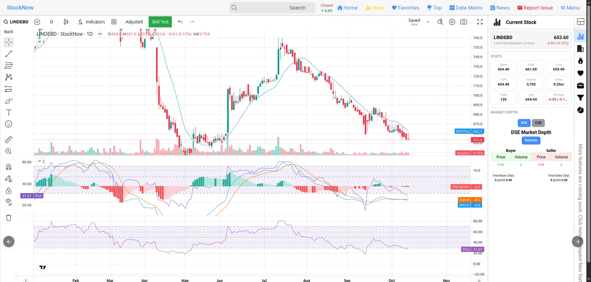

# ট্রেন্ড এমএ এমএসিডি এন্ড আরএসআই - Analysis of Trend, MA, MACD, and RSI

***চার্ট পড়তে শেখা — LINDEBD-এর ট্রেন্ড, MA, MACD ও RSI বিশ্লেষণ***

**উপশিরোনাম:** ডিএসই (DSE) শেয়ারের একটি বাস্তব চার্ট ধরে ধরে টেকনিক্যাল ইন্ডিকেটর বোঝার সহজ বাংলা গাইড  

**বিশ্লেষণের তারিখ:** ১৪ অক্টোবর ২০২৬  
**উৎস:** StockNow প্ল্যাটফর্মের দৈনিক (1D) ক্যান্ডেলস্টিক চার্ট  
**শেয়ার:** LINDEBD (Linde Bangladesh Limited)

## ০. এই অধ্যায়ে কী শিখবেন

এই অধ্যায়ে আপনি শিখবেন কীভাবে একটি বাস্তব চার্ট দেখে টেকনিক্যাল ইন্ডিকেটরগুলো পড়তে হয়। বিশেষ করে:

- মুভিং এভারেজ (MA) দিয়ে ট্রেন্ড চেনা
- MACD প্যানেলের লাইন ও হিস্টোগ্রাম পড়া
- RSI দিয়ে ওভারসোল্ড/ওভারবট বোঝা
- ভলিউম ও লিকুইডিটির গুরুত্ব
- কেনার আগে কোন সংকেতগুলো মিলিয়ে দেখবেন এবং ঝুঁকি কীভাবে সামলাবেন
- টেকনিক্যাল বিশ্লেষণের সীমাবদ্ধতা

চার্ট শুধু অতীতের দামের আচরণ দেখায়। তা দিয়ে সম্ভাবনা বোঝা যায়, নিশ্চয়তা নয়। তাই নির্দিষ্ট সময়ের মধ্যে লাভ বা লোকসানের নিশ্চিত উত্তর কোনো টেকনিক্যাল বিশ্লেষণ দিতে পারে না। যা করা যায় তা হলো চার্টের বর্তমান অবস্থা পড়ে ঝুঁকি-সম্ভাবনার একটা ধারণা তৈরি করা।

## ১. চার্টের তথ্য-সংক্ষেপ (স্ক্রিনশট অনুযায়ী)

| বিষয়               | মান                                |
|---------------------|------------------------------------|
| শেয়ার              | LINDEBD (Linde Bangladesh Limited) |
| বর্তমান দাম (Close) | ৬৫৩.৬০ টাকা                        |
| আজকের পরিবর্তন      | -০.৮০ (-০.১২%)                     |
| Open                | ৬৫৪.৪০                             |
| High                | ৬৬১.০০                             |
| Low                 | ৬৫৩.৪০                             |
| YCP (গতকালের ক্লোজ) | ৬৫৪.৪০                             |
| ভলিউম               | ৩,৭৫৩ শেয়ার                       |
| ভ্যালু              | ০.২৫ কোটি টাকা                     |
| ট্রেড সংখ্যা        | ১২৫                                |
| গড় দাম (Avg)       | ৬৫৪.৯৪                             |
| MA                  | ৬৬২.৭                              |
| MACD                | -৮.৮                               |
| Signal              | -৮.৫                               |
| Histogram           | -০.৩                               |
| RSI                 | ২৭.৬৭                              |

## ২. মুভিং এভারেজ (MA) ও ট্রেন্ড

**MA কী?**  
গত কয়েক দিনের ক্লোজিং দামের গড়। প্রতিদিন নতুন দাম যোগ হয়, পুরনো দাম বাদ যায়। ফলে লাইনটা দামের সাথে সাথে চলে এবং ছোটখাটো ওঠানামা মুছে গিয়ে আসল দিকটা বোঝা যায়।

**নোট:** স্ক্রিনশটে MA কত দিনের গড়, তা লেখা নেই (মান ৬৬২.৭)। ইন্ডিকেটরের সেটিংসে গিয়ে দেখে নেওয়া ভালো। সাধারণত ২০-দিন বা ৫০-দিনের MA বেশি ব্যবহৃত হয়।

***কীভাবে পড়বেন***

| অবস্থা                           | মানে                        |
|----------------------------------|-----------------------------|
| দাম MA-র উপরে                    | তুলনামূলক শক্তিশালী (বুলিশ) |
| দাম MA-র নিচে                    | দুর্বল (বিয়ারিশ)           |
| MA লাইন নিচের দিকে ঢালু          | ডাউনট্রেন্ড নিশ্চিত হয়     |
| MA লাইন সমতল হয়ে উপরে বাঁক নেয় | ট্রেন্ড বদলের ইঙ্গিত        |

**LINDEBD-র ক্ষেত্রে**  

- জুলাইয়ের শুরুতে দাম ৭৬০-এর কাছাকাছি উঠেছিল, তখন দাম MA-র উপরে ছিল।  
- আগস্ট-সেপ্টেম্বরে দাম MA-র নিচে নেমে যায় এবং MA লাইনও নিচের দিকে ঢালু হয়।  
- এখন দাম ৬৫৩.৬০, MA ৬৬২.৭। দাম লাইনের নিচে, তাই ট্রেন্ড এখনো নিম্নমুখী।

## ৩. MACD প্যানেল: তিনটি উপাদান

MACD-র পুরো নাম Moving Average Convergence Divergence। এটি ট্রেন্ডের গতি (momentum) মাপে।

**৩.১ MACD লাইন (নীল, -৮.৮)**  
একটি ছোট মেয়াদের EMA থেকে একটি বড় মেয়াদের EMA বাদ দিলে যা থাকে। সাধারণ সেটিং ১২ ও ২৬ দিন। নেগেটিভ মানে সাম্প্রতিক দাম দীর্ঘ মেয়াদের তুলনায় দুর্বল।

**৩.২ Signal লাইন (কমলা, -৮.৫)**  
MACD লাইনেরই গড় (সাধারণত ৯ দিনের), তাই MACD-র চেয়ে ধীরে চলে। MACD-র জন্য তুলনার মানদণ্ড হিসেবে কাজ করে।

**৩.৩ হিস্টোগ্রাম (বার, -০.৩)**  
হিস্টোগ্রাম = MACD − Signal  
হিসাব: (-৮.৮) − (-৮.৫) = -০.৩  

- শূন্যের উপরে (সবুজ) বার: বুলিশ গতি।  
- শূন্যের নিচে (লাল) বার: বিয়ারিশ গতি।  

বারের উচ্চতা গতির শক্তি দেখায়। বার ছোট হতে থাকলে গতি দুর্বল হচ্ছে।

**৩.৪ ক্রসওভার**
সবচেয়ে গুরুত্বপূর্ণ সংকেত

| ঘটনা                                            | নাম               | সাধারণ ব্যাখ্যা |
|-------------------------------------------------|-------------------|-----------------|
| নীল (MACD) নিচ থেকে কমলা (Signal) কেটে উপরে ওঠে | বুলিশ ক্রসওভার    | কেনার সংকেত     |
| নীল উপর থেকে কমলা কেটে নিচে নামে                | বিয়ারিশ ক্রসওভার | বিক্রির সংকেত   |

**৩.৫ LINDEBD-র MACD এখন কী বলছে**  

- MACD ও Signal দুটোই নেগেটিভ এবং খুব কাছাকাছি (-৮.৮ ও -৮.৫)।  
- আগস্ট-সেপ্টেম্বরে লাল বার বড় ছিল, মানে বিক্রির চাপ তীব্র ছিল। এখন বার প্রায় শূন্যের কাছে (-০.৩), মানে নিম্নমুখী গতি অনেকটা থেমে এসেছে।  
- বুলিশ ক্রসওভার এখনো হয়নি। হলে হিস্টোগ্রাম শূন্য পেরিয়ে সবুজ হবে।

## ৪. RSI (২৭.৬৭)

RSI ০ থেকে ১০০-র মধ্যে চলে এবং দাম কত দ্রুত উঠেছে বা নেমেছে তা মাপে।

| RSI মান    | অবস্থা                                        |
|------------|-----------------------------------------------|
| ৭০-এর উপরে | ওভারবট (বেশি কেনা হয়েছে, নামার সম্ভাবনা)     |
| ৫০         | মাঝামাঝি                                      |
| ৩০-এর নিচে | ওভারসোল্ড (বেশি বিক্রি হয়েছে, ওঠার সম্ভাবনা) |

**LINDEBD:** ২৭.৬৭, অর্থাৎ ওভারসোল্ড অঞ্চলে। একটি স্বল্পমেয়াদি বাউন্সের সম্ভাবনা আছে।  

**সতর্কতা:** ওভারসোল্ড মানে দাম বাড়বেই, এমন নয়। শক্তিশালী ডাউনট্রেন্ডে RSI অনেক দিন ৩০-এর নিচে থেকে যেতে পারে।

## ৫. ভলিউম ও লিকুইডিটি

- আজ ভলিউম মাত্র ৩,৭৫৩টি শেয়ার, ট্রেড ১২৫টি, ভ্যালু ০.২৫ কোটি টাকা। এটা খুব কম।  
- কম ভলিউমে দামের ওঠানামা কম হয়, কিন্তু লিকুইডিটিও কম। বিক্রি করতে চাইলে ক্রেতা না-ও পাওয়া যেতে পারে, অথবা কাঙ্ক্ষিত দামে বেচা যায় না।  
- দাম বাড়ার সময় ভলিউম না বাড়লে সেই ওঠা অনেক সময় ভুয়া সংকেত হয়।  
- স্ক্রিনশটে ডিএসই মার্কেট ডেপথ খালি দেখাচ্ছে (০.০০), কারণ সম্ভবত বাজার তখন বন্ধ ছিল।

## ৬. সব মিলিয়ে সারসংক্ষেপ

| ইন্ডিকেটর        | বর্তমান অবস্থা              | অর্থ                          |
|------------------|-----------------------------|-------------------------------|
| ট্রেন্ড / MA     | দাম MA-র নিচে               | নিম্নমুখী                     |
| MACD বনাম Signal | MACD সামান্য নিচে, কাছাকাছি | বিয়ারিশ, তবে ক্রসওভারের কাছে |
| হিস্টোগ্রাম      | -০.৩                        | বিক্রির চাপ কমছে              |
| RSI              | ২৭.৬৭                       | ওভারসোল্ড, বাউন্সের সম্ভাবনা  |
| ভলিউম            | খুব কম                      | লিকুইডিটি ঝুঁকি               |

**সহজ কথায়:** ট্রেন্ড এখনো নিচের দিকে, কিন্তু নামার গতি কমে আসছে এবং RSI বলছে অনেক বিক্রি হয়ে গেছে। ঘুরে দাঁড়ানোর একটা সম্ভাবনা তৈরি হচ্ছে, কিন্তু তা এখনো নিশ্চিত হয়নি। এই মুহূর্তে কেনা তুলনামূলক ঝুঁকিপূর্ণ।

## ৭. কেনার আগে যে সংকেতগুলো মিলিয়ে দেখবেন

1. নীল MACD লাইন কমলা Signal লাইন কেটে উপরে উঠছে কি না।  
2. হিস্টোগ্রামের বার সবুজ হচ্ছে কি না।  
3. দাম MA-র (~৬৬২-৬৬৫) উপরে উঠে কয়েক দিন টিকছে কি না।  
4. ওঠার সময় ভলিউম বাড়ছে কি না।  

একটা ইন্ডিকেটর দেখে সিদ্ধান্ত নেওয়া ঠিক নয়। তিন-চারটা সংকেত একসাথে মিললে ভরসা বাড়ে।

## ৮. ঝুঁকি ব্যবস্থাপনার প্রাথমিক নিয়ম

- **স্টপ-লস রাখুন:** যেমন সাম্প্রতিক নিম্নমান ৬৫০-এর নিচে। দাম ওই স্তরের নিচে নামলে লোকসান মেনে নিয়ে বের হয়ে যাওয়ার পূর্বনির্ধারিত নিয়ম।  
- একসাথে পুরো টাকা নয়: অল্প অল্প করে ঢুকুন।  
- যতটুকু হারাতে পারবেন ততটুকুই বিনিয়োগ করুন।  
- কম ভলিউমের শেয়ারে বিশেষ সতর্ক থাকুন, কারণ বের হওয়া কঠিন হতে পারে।

## ৯. টেকনিক্যাল বিশ্লেষণের সীমাবদ্ধতা

এই অধ্যায়ের সবকিছু শুধু চার্ট ও অতীতের দামের ওপর ভিত্তি করা। এগুলো এখানে নেই:

- কোম্পানির আর্থিক অবস্থা: EPS, মুনাফা, ডিভিডেন্ড, ঋণ  
- খাত ও খবর: গ্যাস/এনার্জি খাতের পরিস্থিতি, কোম্পানির ঘোষণা  
- বাজারের সামগ্রিক অবস্থা ও নীতিগত পরিবর্তন  

প্রকৃত সিদ্ধান্তের আগে এগুলোও যাচাই করা দরকার।

## ১০. শব্দকোষ

| শব্দ               | মানে                                              |
|--------------------|---------------------------------------------------|
| বুলিশ (Bullish)    | দাম বাড়ার প্রবণতা                                |
| বিয়ারিশ (Bearish) | দাম কমার প্রবণতা                                  |
| MA                 | মুভিং এভারেজ, নির্দিষ্ট দিনের গড় দাম             |
| EMA                | সাম্প্রতিক দামকে বেশি গুরুত্ব দেওয়া মুভিং এভারেজ |
| MACD               | দুই EMA-র পার্থক্য দিয়ে গতি মাপার ইন্ডিকেটর      |
| Signal লাইন        | MACD-র গড়, তুলনার মানদণ্ড                        |
| হিস্টোগ্রাম        | MACD ও Signal-এর পার্থক্য                         |
| ক্রসওভার           | দুটি লাইনের একে অপরকে কেটে যাওয়া                 |
| RSI                | দামের গতির সূচক (০-১০০)                           |
| ওভারসোল্ড          | বেশি বিক্রি হয়েছে (RSI < ৩০)                     |
| ওভারবট             | বেশি কেনা হয়েছে (RSI > ৭০)                       |
| ভলিউম              | নির্দিষ্ট সময়ে হাতবদল হওয়া শেয়ারের সংখ্যা      |
| লিকুইডিটি          | সহজে কেনাবেচা করার সুযোগ                          |
| স্টপ-লস            | লোকসান সীমিত রাখার পূর্বনির্ধারিত বিক্রির দাম     |
| YCP                | গতকালের ক্লোজিং প্রাইস                            |

**দাবিত্যাগ (Disclaimer)**  
এই অধ্যায় শুধু শিক্ষামূলক উদ্দেশ্যে লেখা। এটি আর্থিক, বিনিয়োগ বা ট্রেডিং পরামর্শ নয়। কোনো শেয়ার কেনা বা বেচার সুপারিশ করা হচ্ছে না। শেয়ারবাজারে লোকসান হতে পারে। যেকোনো বিনিয়োগ সিদ্ধান্ত নিজের দায়িত্বে এবং প্রয়োজনে যোগ্য আর্থিক উপদেষ্টার সাথে পরামর্শ করে নিন।
